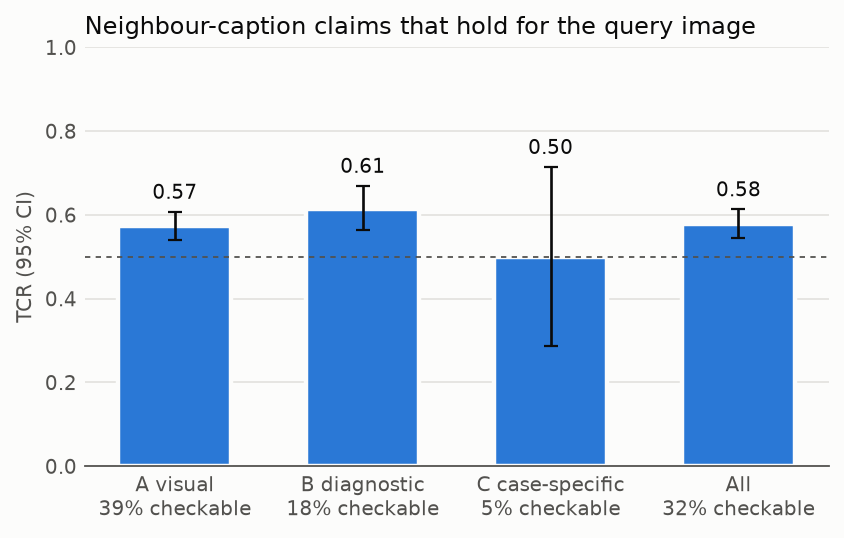
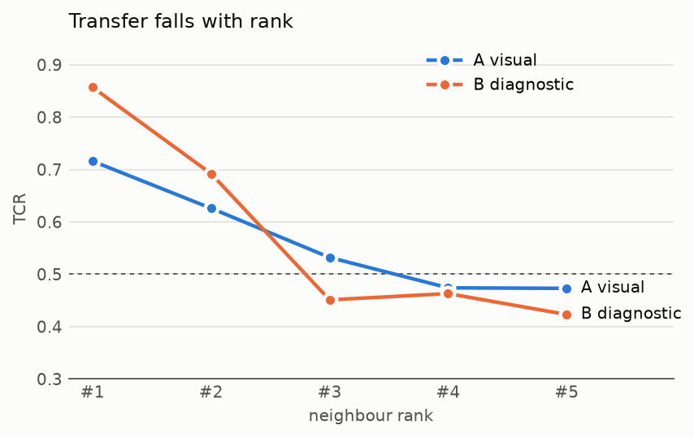
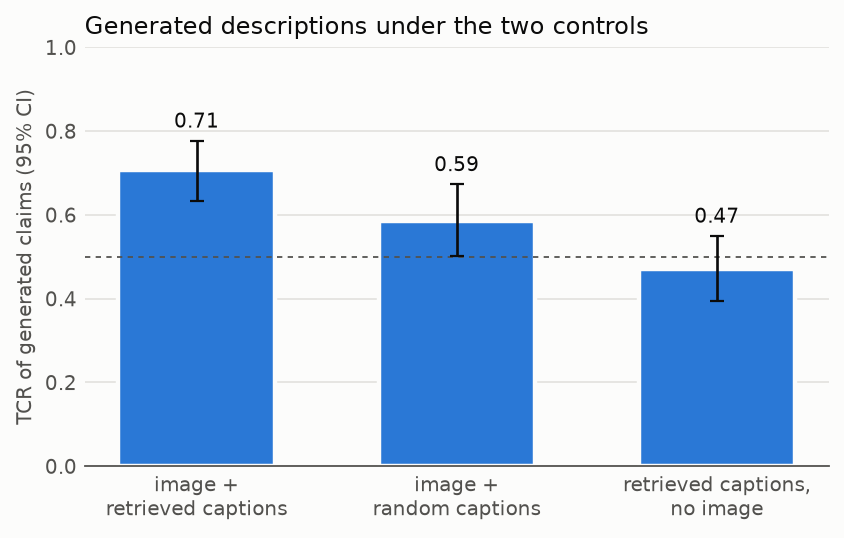
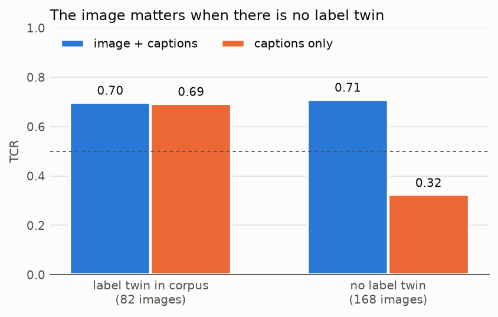

<!-- This is the source of docs/report.md. Edit this file, then run `uv run pathscope report`.
Anything in double braces is filled in from the result files, so don't type numbers by hand. -->

# PathScope: do the captions of similar pathology images describe a new one?

Yash Manohar Yeole · CS594 Vector Databases, University of Illinois Chicago · Fall 2026

Code: <https://github.com/yashmyeole/pathscope> · Demo: *(Vercel URL to be added)*

*Research project. Nothing here is fit for clinical use.*

## Abstract

Retrieval-augmented systems for pathology images usually assume that if two images look alike in
embedding space, the caption of one says something true about the other. This project measures that
assumption instead. Each test image from PathVQA retrieves its five
nearest neighbours from a {{p1.corpus.rows|int}}-image corpus (PathVQA train plus ARCH) using PLIP
embeddings stored in Qdrant. Every neighbour caption is split into single claims, sorted into
visual, diagnostic and case-specific tiers, and checked against what PathVQA records about the
test image. Of the claims that could be checked, **{{p4.overall.tcr|pct}}** were true of the new
image (95% CI {{p4.overall.ci95|ci}}). Visual and diagnostic claims transferred at about the same
rate, and transfer fell steadily with neighbour rank: diagnostic claims from the top neighbour held
{{p4.by_tier_and_rank.B|1.tcr|pct}} of the time, and from rank 3 on they did worse than a coin flip.
When a vision-language model writes a description from the image and the retrieved captions, its
claims hold {{p5.full.tcr|pct}} of the time, against {{p5.blind.tcr|pct}} when it gets the captions
without the image and {{p5.random.tcr|pct}} when it gets the image with random captions. The image
gain is concentrated in the two thirds of test images that have no copy of the same textbook figure
in the corpus. There, captions alone hold only {{p5.by_label_match.false.tcr.blind|pct}} of the
time.

## 1. The question

A system that answers "what is this image?" by finding similar images and reusing their captions is
cheap and easy to explain. It is also only as good as the claim hidden inside it: that a caption
travels to a similar-looking image. In pathology that claim is shaky. Two slides can share a stain,
a magnification and a colour palette and still show different organs and different diseases. And
some of what a caption says (the patient's age, the tumour's size, the margins) can't be read off
any image at all.

So the question here is narrow and measurable: **when PLIP retrieves the nearest images to a new
pathology image, how much of what their captions say is true of the new image, and which kinds of
statement survive the trip?** The headline metric is the transferable claim rate:

> TCR = supported / (supported + contradicted)

Claims the evidence says nothing about are reported as *silent* and never counted as wrong.

## 2. Data and leakage control

**PathVQA** (He et al., 2020) has {{p0.splits.train.unique_images|int}} train,
{{p0.splits.validation.unique_images|int}} validation and {{p0.splits.test.unique_images|int}} test
images, identified here by an MD5 of the decoded pixels because the Hugging Face release has no
image ids. It has question/answer pairs but no captions, so each image gets a pseudo-caption made of
its non-yes/no answers. The median answer is one word. The images are textbook figures, not just
histology: roughly 45% micrographs, 35% gross specimens and 15% clinical photographs.

**ARCH** (Gamper and Rajpoot, 2021) adds {{p1.corpus.by_source.arch_books|int}} textbook and
{{p1.corpus.by_source.arch_pubmed|int}} PubMed figures with real captions. It goes into the corpus
only, since it has no held-out questions to check claims against.

PathVQA was split by question rows, not by figure, so the same figure or the same case often sits
on both sides. Three checks removed test images whose twin was in the corpus:

| check | test images flagged |
|---|---|
| identical pixels (MD5) | {{p1.queries_test.exact.n|int}} |
| near-duplicate (256-bit pHash, distance ≤ 58, grey zone 59–86 reviewed by hand) | {{p1.queries_test.near.n|int}} |
| same figure legend (longest answer of ≥ 6 words matching a corpus text at token-sort ratio ≥ 85) | {{p1.queries_test.text.n|int}} |
| any | {{p1.queries_test.any.n|int}} ({{p1.queries_test.any.pct|1f}}%) |

That leaves **{{p1.queries_test.clean_queries|int}} test queries** and a corpus of
{{p1.corpus.rows|int}} images. Every flagged pair was PathVQA test against PathVQA train; ARCH
shared nothing with PathVQA. The usual "pHash distance ≤ 10" rule would have missed about 80% of the
real duplicates, because these are re-photographed and re-cropped figures rather than byte copies.

Short diagnosis labels that two different images can legitimately share ("metastatic carcinoma")
were *not* removed. Test images whose label appears word for word in the corpus are flagged
`label_match`. This turns out to matter a lot (Section 5.4).

## 3. System

- **Embeddings.** PLIP (`vinid/plip`, ViT-B/32, Huang et al., 2023), one 512-d vector per image,
  computed once and stored in Parquet.
- **Vector store.** Qdrant Cloud free tier: one collection for the corpus and one for the queries,
  cosine distance, the image's pixel MD5 as the point id. Qdrant's top 5 matched an exact numpy
  search on 60 of 60 queries checked, and on 249 of the 250 demo queries (the other has tied
  scores). A search takes a few milliseconds. A scheduled GitHub Action pings the cluster every
  three days so the free tier doesn't delete it.
- **Retrieval.** k = 5 nearest corpus images per test query.
- **Demo.** A Next.js site on Vercel with a gallery of 250 test images. Each page shows the five
  neighbours (fetched live from Qdrant), what PathVQA records about the image, and the three
  generated descriptions with every claim marked by tier and verdict. No model runs at request
  time.

Everything uses free tiers: Groq (`openai/gpt-oss-120b`) for claim extraction and Gemini
(`gemini-3.5-flash-lite`) for checking and generation. Every LLM response is cached, so a run that
hits a daily limit resumes the next day.

## 4. Measuring transfer

**Claims.** Each neighbour caption is split into atomic claims, and each claim is tagged A (visual:
organ, stain, tissue, cells), B (diagnostic: disease or process) or C (case-specific: patient,
grade, size, history). Against {{x.ref_claims|int}} hand-written claims for {{x.captions|int}}
captions, the extractor reached recall {{x.recall|2f}}, precision {{x.precision|2f}} and tier
agreement {{x.tier_agreement_on_matched|2f}}. The reference was written by whoever tuned the
prompt, so treat these as upper bounds.

**Checking.** Each claim is judged supported, contradicted or silent against the query image's own
PathVQA answers. A different model family judges than extracts. PathVQA's "no" answers are left out
of the evidence: the dataset makes them by pasting a phrase from another figure into a true
question, so they say nothing reliable about the image.

**Judge agreement.** {{p4.judge_kappa_vs_label_ref.n|int}} judge decisions, over-sampling
supported and contradicted ones, were labelled again blind to the judge's answer (column
`label_ref` in `eval/phase4/judge_sample.csv`; `eval/phase4/report.md` says how it was made).
Agreement was
{{p4.judge_kappa_vs_label_ref.agreement|pct}} (Cohen's κ = {{p4.judge_kappa_vs_label_ref.kappa|2f}}).
The judge never disagreed on "supported". Most disagreements were contradictions it called silent
because the conflicting organ was buried in a longer answer, so if anything it makes TCR slightly
optimistic. The reference labels are not a pathologist's, which matters most for diagnostic
claims.

**Confidence intervals** come from 1,000 bootstrap resamples of whole queries, since claims from
one query aren't independent.

## 5. Results

### 5.1 Retrieval is mediocre, and partly for the wrong reasons

Fifty random queries were inspected by hand. The neighbours were related (same organ or main
finding) for {{p3.hand_review.verdict.related|int}} of them, loosely related for
{{p3.hand_review.verdict.loose|int}} and unrelated for {{p3.hand_review.verdict.unrelated|int}}.
Over all {{p3.automatic.n_queries|int}} queries, the top neighbour shared an organ keyword with the
query {{p3.automatic.organ_top1.rate|pct}} of the time, against
{{p3.automatic.organ_chance_one_random|pct}} for a random corpus image. Micrographs did much better
({{p3.automatic.organ_top1_by_query_type.micrograph.rate|pct}}) than photos
({{p3.automatic.organ_top1_by_query_type.photo.rate|pct}}). On gross photos PLIP matches the
background (the same blue towel, the same black cloth) and the colour of the specimen, not the
organ.

Two caveats run through everything that follows:

- **Neighbours come from the same textbooks.** {{p3.automatic.neighbour_source_share.pathvqa_train.top5|pct}}
  of all neighbours are PathVQA train images, though they are only
  {{p3.automatic.neighbour_source_share.pathvqa_train.corpus|pct}} of the corpus.
- **Same-case sisters.** In {{p3.hand_review.same_case_in_top5.rate|pct}} of the hand-reviewed
  queries, a second photo of the same specimen was in the top 5. The leakage checks remove copies of
  a picture, not other pictures of the same case.

The embeddings themselves are fine. Cross-modal retrieval on ARCH lands on the numbers published
for PLIP in the Quilt-1M paper (Ikezogwo et al., 2023, Table 2), in percent:

{{table:crossmodal}}

### 5.2 How much of a neighbour's caption transfers

{{p4.queries|int}} queries, {{p4.overall.claims|int}} claim checks (a claim is checked once for
every query that retrieves its caption):

{{table:tiers}}



**A little under 60% of the checkable claims are true of the new image.** Counting every silent
claim as a failure instead gives a floor of {{p4.overall.tcr_lower|2f}}.

**Visual and diagnostic claims transfer at about the same rate.** We expected visual claims to
transfer clearly better. Two things work against them. Most checkable visual claims are about the
organ, the one thing PathVQA states directly, so they are the easiest to contradict. And diagnostic
claims can only be checked when the query's answers name a disease, which mostly happens when
retrieval already worked.

**Case-specific claims can't be measured on this data.** {{p4.by_tier.C.decided|pct}} of them were
checkable, and the interval spans {{p4.by_tier.C.ci95|ci}}. PathVQA records almost nothing about
the patient, so this is a limit of the evidence, not a finding that half of them transfer.

**Rank matters more than similarity.**

{{table:rank}}



The top neighbour's diagnosis holds {{p4.by_tier_and_rank.B|1.tcr|pct}} of the time. From rank 3
on it is wrong more often than right. Yet across queries, a neighbour's raw cosine score barely
predicts how well it transfers (Spearman ρ = {{p4.similarity_vs_tcr_spearman.rho|2f}} over
{{p4.similarity_vs_tcr_spearman.pairs|int}} neighbour pairs). Position within the list carries
information; the similarity number on its own does not. PLIP scores are bunched tightly (median
top-1 cosine {{p3.automatic.top1_score.50%|2f}}), so the same score means different things for
different queries.

**Image kind and neighbour source** (TCR, with the number of checkable claims in brackets):

{{table:kinds}}

{{table:sources}}

Photos are the weak spot, as the retrieval check predicted. ARCH neighbours are rare and almost
never checkable: their captions use a different vocabulary from PathVQA's one-word answers. The
overall numbers are essentially PathVQA-to-PathVQA transfer.

**Same-case neighbours inflate diagnostic transfer.** Among the hand-reviewed queries, diagnostic
claims held in {{p4.reviewed_50_by_same_case.B|y.supported|int}} of
{{p4.reviewed_50_by_same_case.B|y.decided_n|int}} checkable claims when a sister image of the same
case was in the top 5, against {{p4.reviewed_50_by_same_case.B|n.supported|int}} of
{{p4.reviewed_50_by_same_case.B|n.decided_n|int}} without one. The samples are small, but part of what
looks like transfer is the same case showing up twice.

### 5.3 Generating a description, and two controls

For 250 random test queries, Gemini wrote a 3–5 sentence description three ways: from the image
and its five retrieved captions (*full*), from the same captions without the image (*captions
only*), and from the image with five random corpus captions of the same sources (*random*). Each
description went through the same claim checks.

{{table:conditions}}

{{table:gains}}



- **The full system beats both controls.** The image adds {{p5.multimodal_gain.all.gain|signed}}
  TCR and the right captions add {{p5.retrieval_gain.all.gain|signed}}. Both intervals exclude
  zero, and the image matters about twice as much.
- **Writing a description filters the neighbours.** Generated claims hold
  {{p5.full.tcr|pct}} of the time, against {{p4.overall.tcr|pct}} for the raw neighbour claims.
  With the image in view, the model drops much of what the lower-ranked neighbours get wrong.
- **Without the image, the model guesses.** Captions-only descriptions make about twice as many
  contradicted claims per description. Copying isn't the cause. The model blends five captions
  that disagree and commits to one answer. In one case it called a breast carcinoma "adenocarcinoma
  of the prostate".
- **Copying doesn't explain the full system's score.** {{p5.full.copy_rate|pct1}} of its claims
  are near-verbatim from a caption. Those hold at {{p5.full_copied_vs_not.copied.tcr|2f}} and the
  rest at {{p5.full_copied_vs_not.not_copied.tcr|2f}}.
- **Retrieval helps visual claims more than diagnostic ones.** The tier B retrieval gain has an
  interval that crosses zero, which fits the rank result above: only the top one or two diagnoses
  are reliable.

### 5.4 The image only matters when there is no label twin

{{table:twins}}



Splitting by `label_match` explains the image gain. When the corpus holds an image with the same
short label (usually another panel of the same textbook figure), captions alone do as well as
captions plus the image. For the other {{p5.by_label_match.false.queries|int}} queries, captions
alone are wrong more often than right, and the full system holds at
{{p5.by_label_match.false.tcr.full|2f}} only because the model can see the picture.

This is the most important result for anyone using PathVQA to evaluate retrieval-augmented
description. A third of its test images have a twin label in the training split, and on those a
model that never looks at the image looks as good as one that does. An evaluation that doesn't
split on this will overstate how much the system "reads" the image on average, and understate it on
the images that are actually new.

## 6. Limitations

- **No pathologist.** Judge agreement was measured against non-expert reference labels. The
  visual tier is mostly about reading short answers; the diagnostic tier needs an expert, so its
  numbers are provisional.
- **The same model writes and checks the Phase 5 descriptions.** The judge never sees the image,
  which limits self-preference, but a judge from a different model family on a sample would settle
  it. The κ above was measured on caption claims, not generated ones.
- **Most claims can't be checked.** Only {{p4.overall.decided|pct}} of neighbour claims and
  {{p5.full.decided|pct}} of generated ones are decidable against PathVQA's answers. TCR here is
  really about organs, image type and the main diagnosis. Stain, morphology and patient details
  are mostly silent.
- **One encoder, one generator, one prompt.** CONCH or UNI might retrieve better. A stronger
  generator might close the captions-only gap, or widen it.
- **Same-case leakage.** The checks remove copies of a picture, not other pictures of the same
  specimen. `label_match` is a proxy, not a fix.
- **Free tiers shaped the scale.** 250 queries for generation, not all {{p1.queries_test.clean_queries|int}}.

## 7. Conclusion

Captions of similar-looking pathology images are a weak source of truth about a new image. Of the
checkable claims, about {{p4.overall.tcr|pct}} transfer, the diagnosis from the top neighbour
usually does, and past the second neighbour it is close to a coin flip. Similarity scores don't tell
you which neighbours to trust; rank does, a little. A vision-language model that sees the image
uses the retrieved captions well ({{p5.full.tcr|2f}} TCR, little copying). Without the image the
same captions mislead it, except when the dataset already contains a copy of the figure.

The natural next step is a reranker trained on these TCR labels: given a query and its neighbours,
predict which captions will transfer, and keep only those. Other follow-ups are a second judge
family, a pathologist-labelled sample for the diagnostic tier, and a larger, figure-level-split
corpus such as Quilt-1M.

## Reproducing this report

```bash
git clone https://github.com/yashmyeole/pathscope && cd pathscope
uv sync
uv run pathscope report
```

`pathscope report` rebuilds every number, table and figure here from the committed verdict tables
in `eval/` and the split manifests in `data/manifests/`, checks them against the saved
`tcr.json` and `results.json`, and rewrites this file from `docs/report.template.md`. Rerunning
the LLM steps themselves needs free Groq and Gemini keys and a few days of daily quota (see the
README).

## References

- He, X. et al. *PathVQA: 30000+ questions for medical visual question answering.* arXiv:2003.10286, 2020.
- Gamper, J. and Rajpoot, N. *Multiple instance captioning: learning representations from histopathology textbooks and articles (ARCH).* CVPR 2021.
- Huang, Z. et al. *A visual–language foundation model for pathology image analysis using medical Twitter (PLIP).* Nature Medicine, 2023.
- Ikezogwo, W. et al. *Quilt-1M: one million image-text pairs for histopathology.* NeurIPS Datasets and Benchmarks, 2023.
